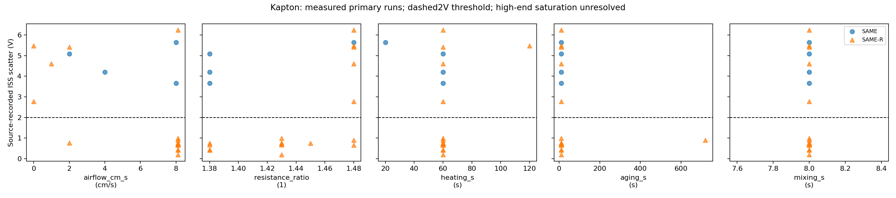
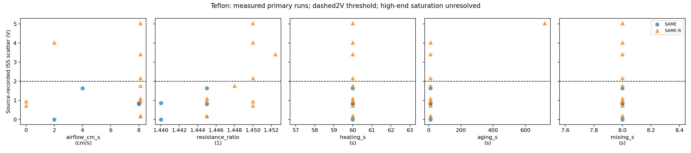

# Model C follow-up evaluation

Status: TESTED_LOCALLY. Evaluation and reporting only; deployed weights and inference bundle are byte-for-byte unchanged.

The original0.870152 headline evaluates nested model selection, not a fixed forest: outer folds selected tree, forest, tree, tree and logistic. We retain it and compare a fixed forest and a training-fold-only material-majority baseline on exactly the saved outer groups. This is a post-hoc diagnostic, not a fresh independent test or a new selection-unbiased estimate. The baseline is also evaluated inside the same4-fold inner splits, without changing original selections. Majority ties choose0; unseen material falls back to training-global majority.

| Method | Mean balanced accuracy | Fold SD |
|---|---:|---:|
|material_majority|0.891342|0.048823|
|fixed_forest|0.900433|0.056572|
|original_nested_selection|0.870152|0.076360|

| Fold | Material majority | Fixed forest | Forest minus material majority | Original nested selection minus material majority |
|---|---:|---:|---:|---:|
|0|0.875000|0.875000|0.000000|-0.041667|
|1|0.875000|0.875000|0.000000|0.000000|
|2|0.833333|0.833333|0.000000|0.000000|
|3|0.964286|0.964286|0.000000|0.035714|
|4|0.909091|0.954545|0.045455|-0.100000|

Forest-minus-material-majority mean±SD: **0.009091 ± 0.020328**. This is descriptive fold variability, not a confidence interval.

The fixed forest has a slightly higher numerical mean than material majority, but the advantage is smaller than one forest fold SD, so they are tied under the original evaluation rule. Four of five paired differences are zero. **Material identity explains the headline score**: the material-only baseline exceeds the original nested-selection headline. There is no demonstrated improvement from controlled conditions beyond that baseline; the small retrospective forest advantage is not an independent generalization claim.

## Kapton and Teflon

Counts below use primary heating runs only. Groups retain the original conservative connections, including the ambiguous51a linkage. A group can appear in both class counts if it contains conflicting outcomes; class-group counts need not sum to total groups. Both classes require at least3 groups before fitting an untuned three-fold stratified grouped logistic diagnostic on numeric controls only.

| Material | Runs | Groups | Below2V runs/groups | Atleast2V runs/groups | Logistic pooled OOF balanced accuracy |
|---|---:|---:|---|---|---:|
|Kapton|21|19|12/10|9/9|0.5833333333333334|
|Teflon|15|15|11/11|4/4|0.7386363636363636|

### Kapton

`{"n_runs": 21, "n_groups": 19, "class_balance": {"0": {"runs": 12, "groups": 10}, "1": {"runs": 9, "groups": 9}}, "class_definition": "0=ISS scatter below2V,1=atleast2V", "features": ["airflow_cm_s", "resistance_ratio", "heating_s", "aging_s", "mixing_s"], "scope": "Post-hoc within-material diagnostic; fixed C1 balanced logistic; no model export or deployment claim", "status": "TESTED_LOCALLY", "folds": [{"fold": 0, "train_groups": ["group-009", "group-011", "group-015", "group-028", "group-058", "group-065", "group-085", "group-095", "group-098", "group-112", "group-114", "group-126", "group-131"], "test_groups": ["group-023", "group-045", "group-061", "group-069", "group-096", "group-133"], "model": {"n": 6, "positive": 2, "negative": 4, "precision": 0.0, "recall": 0.0, "f1": 0.0, "balanced_accuracy": 0.375, "confusion_matrix": [[3, 1], [2, 0]], "pr_auc_average_precision": 0.26666666666666666}, "majority": {"n": 6, "positive": 2, "negative": 4, "precision": 0.0, "recall": 0.0, "f1": 0.0, "balanced_accuracy": 0.5, "confusion_matrix": [[4, 0], [2, 0]], "pr_auc_average_precision": null}}, {"fold": 1, "train_groups": ["group-009", "group-011", "group-015", "group-023", "group-045", "group-058", "group-061", "group-069", "group-095", "group-096", "group-114", "group-131", "group-133"], "test_groups": ["group-028", "group-065", "group-085", "group-098", "group-112", "group-126"], "model": {"n": 8, "positive": 2, "negative": 6, "precision": 1.0, "recall": 1.0, "f1": 1.0, "balanced_accuracy": 1.0, "confusion_matrix": [[6, 0], [0, 2]], "pr_auc_average_precision": 1.0}, "majority": {"n": 8, "positive": 2, "negative": 6, "precision": 0.25, "recall": 1.0, "f1": 0.4, "balanced_accuracy": 0.5, "confusion_matrix": [[0, 6], [0, 2]], "pr_auc_average_precision": null}}, {"fold": 2, "train_groups": ["group-023", "group-028", "group-045", "group-061", "group-065", "group-069", "group-085", "group-096", "group-098", "group-112", "group-126", "group-133"], "test_groups": ["group-009", "group-011", "group-015", "group-058", "group-095", "group-114", "group-131"], "model": {"n": 7, "positive": 5, "negative": 2, "precision": 0.5, "recall": 0.2, "f1": 0.2857142857142857, "balanced_accuracy": 0.35, "confusion_matrix": [[1, 1], [4, 1]], "pr_auc_average_precision": 0.81}, "majority": {"n": 7, "positive": 5, "negative": 2, "precision": 0.0, "recall": 0.0, "f1": 0.0, "balanced_accuracy": 0.5, "confusion_matrix": [[2, 0], [5, 0]], "pr_auc_average_precision": null}}], "pooled_oof": {"n": 21, "positive": 9, "negative": 12, "precision": 0.6, "recall": 0.3333333333333333, "f1": 0.42857142857142855, "balanced_accuracy": 0.5833333333333334, "confusion_matrix": [[10, 2], [6, 3]], "pr_auc_average_precision": 0.4586404054799308}, "pooled_majority": {"n": 21, "positive": 9, "negative": 12, "precision": 0.25, "recall": 0.2222222222222222, "f1": 0.23529411764705882, "balanced_accuracy": 0.3611111111111111, "confusion_matrix": [[6, 6], [7, 2]], "pr_auc_average_precision": null}, "fold_balanced_accuracy": {"values": [0.375, 1.0, 0.35], "mean": 0.5750000000000001, "std": 0.36827299656640594}, "undefined_fold_policy": "Single-class test folds have null balanced accuracy; excluded from fold mean, included in pooled OOF."}`

### Teflon

`{"n_runs": 15, "n_groups": 15, "class_balance": {"0": {"runs": 11, "groups": 11}, "1": {"runs": 4, "groups": 4}}, "class_definition": "0=ISS scatter below2V,1=atleast2V", "features": ["airflow_cm_s", "resistance_ratio", "heating_s", "aging_s", "mixing_s"], "scope": "Post-hoc within-material diagnostic; fixed C1 balanced logistic; no model export or deployment claim", "status": "TESTED_LOCALLY", "folds": [{"fold": 0, "train_groups": ["group-004", "group-008", "group-019", "group-035", "group-037", "group-073", "group-077", "group-091", "group-120", "group-130"], "test_groups": ["group-005", "group-027", "group-057", "group-081", "group-110"], "model": {"n": 5, "positive": 2, "negative": 3, "precision": 0.5, "recall": 1.0, "f1": 0.6666666666666666, "balanced_accuracy": 0.6666666666666666, "confusion_matrix": [[1, 2], [0, 2]], "pr_auc_average_precision": 1.0}, "majority": {"n": 5, "positive": 2, "negative": 3, "precision": 0.0, "recall": 0.0, "f1": 0.0, "balanced_accuracy": 0.5, "confusion_matrix": [[3, 0], [2, 0]], "pr_auc_average_precision": null}}, {"fold": 1, "train_groups": ["group-004", "group-005", "group-027", "group-035", "group-037", "group-057", "group-077", "group-081", "group-110", "group-130"], "test_groups": ["group-008", "group-019", "group-073", "group-091", "group-120"], "model": {"n": 5, "positive": 0, "negative": 5, "precision": 0.0, "recall": 0.0, "f1": 0.0, "balanced_accuracy": null, "confusion_matrix": [[4, 1], [0, 0]], "pr_auc_average_precision": null}, "majority": {"n": 5, "positive": 0, "negative": 5, "precision": 0.0, "recall": 0.0, "f1": 0.0, "balanced_accuracy": null, "confusion_matrix": [[5, 0], [0, 0]], "pr_auc_average_precision": null}}, {"fold": 2, "train_groups": ["group-005", "group-008", "group-019", "group-027", "group-057", "group-073", "group-081", "group-091", "group-110", "group-120"], "test_groups": ["group-004", "group-035", "group-037", "group-077", "group-130"], "model": {"n": 5, "positive": 2, "negative": 3, "precision": 1.0, "recall": 0.5, "f1": 0.6666666666666666, "balanced_accuracy": 0.75, "confusion_matrix": [[3, 0], [1, 1]], "pr_auc_average_precision": 1.0}, "majority": {"n": 5, "positive": 2, "negative": 3, "precision": 0.0, "recall": 0.0, "f1": 0.0, "balanced_accuracy": 0.5, "confusion_matrix": [[3, 0], [2, 0]], "pr_auc_average_precision": null}}], "pooled_oof": {"n": 15, "positive": 4, "negative": 11, "precision": 0.5, "recall": 0.75, "f1": 0.6, "balanced_accuracy": 0.7386363636363636, "confusion_matrix": [[8, 3], [1, 3]], "pr_auc_average_precision": 0.775}, "pooled_majority": {"n": 15, "positive": 4, "negative": 11, "precision": 0.0, "recall": 0.0, "f1": 0.0, "balanced_accuracy": 0.5, "confusion_matrix": [[11, 0], [4, 0]], "pr_auc_average_precision": null}, "fold_balanced_accuracy": {"values": [0.6666666666666666, 0.75], "mean": 0.7083333333333333, "std": 0.05892556509887899}, "undefined_fold_policy": "Single-class test folds have null balanced accuracy; excluded from fold mean, included in pooled OOF."}`

No fitted within-material models are serialized or used by inference. These are small, post-hoc condition diagnostics. Single-class test folds receive null balanced accuracy; pooled OOF scores retain all runs. Scatter relationships are descriptive and confounded by the experimental test matrix, campaign and reused samples; they are not causal effects.

## Measured-only dashboard

`data/processed/dashboard_measured_only.csv` contains one row per material: primary-run counts, groups, count and fraction reaching2V, source test IDs, campaign coverage and min/max of every controlled condition with units. It contains no model prediction or synthetic observations. Fractions and ranges are deterministic derivations from measured/source-reported data, not estimated detection probabilities. Reburn runs count as runs, and group counts expose dependence. Constant controls appear as identical lower/upper limits in the figures.

Reproduce without retraining or changing weights: `python -m model_c.evaluate_followup`. The original notebook and model-training results retain their historical Colab status; this addendum was executed locally. `reports/followup_metrics.json` includes all fold memberships, inner baseline scores, OOF metrics, source hashes and the protected deployed-artifact hashes.
